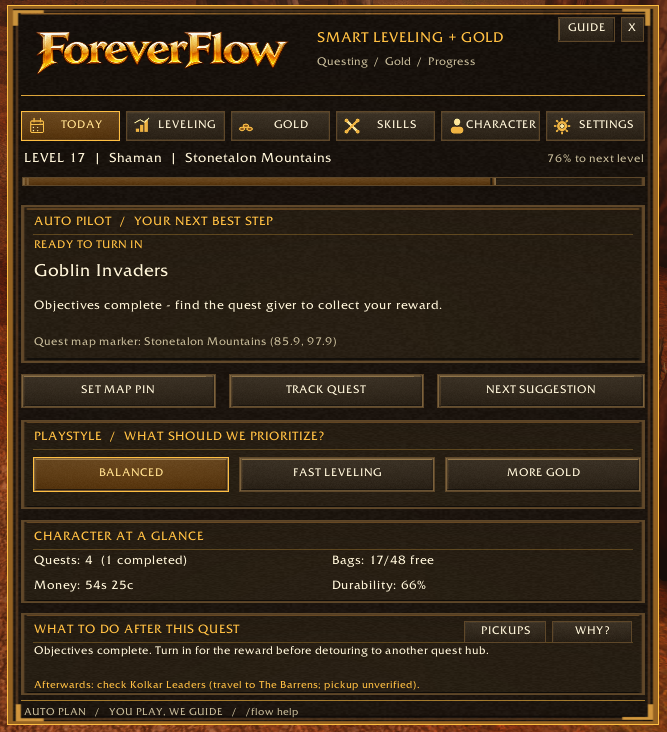
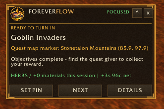
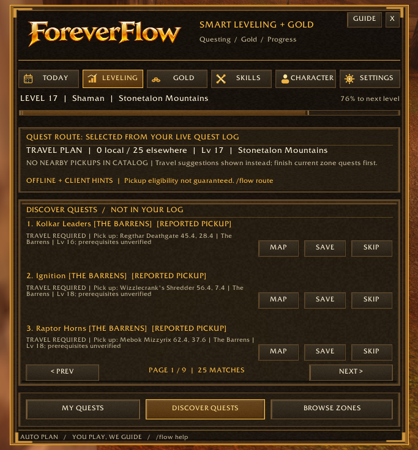
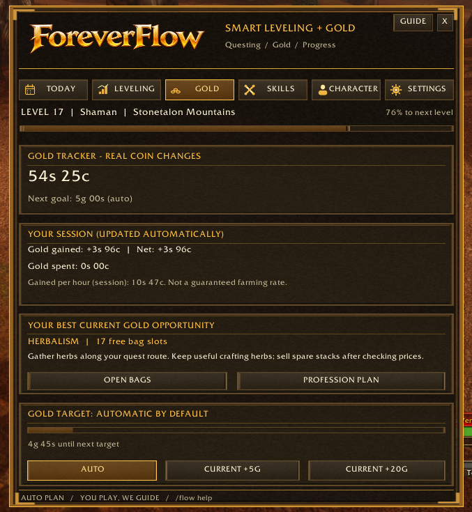
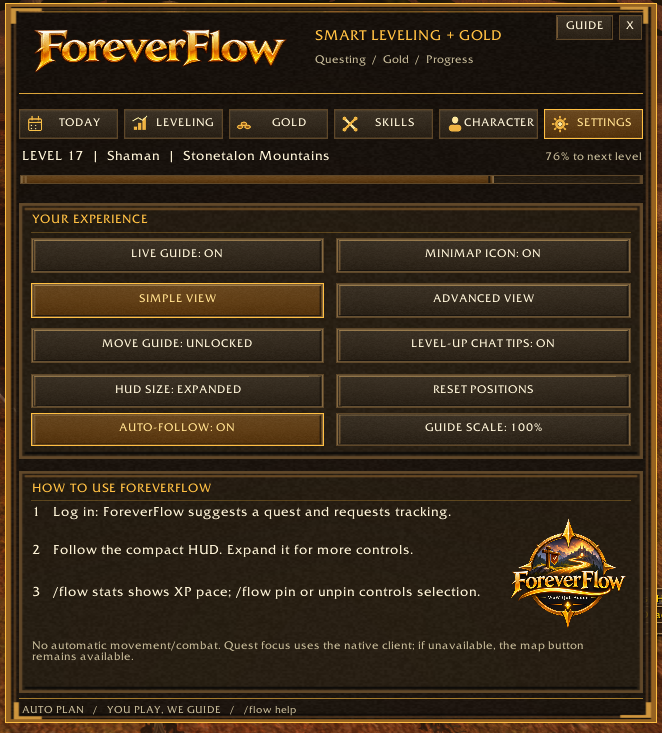

# ✦ ForeverFlow ✦

### Your adventure. A little more direction.

**Smart leveling · Discover Quests · Route Intelligence · Gold & Professions**

*Built for World of Warcraft: Forever*

**You play. ForeverFlow helps you decide what to do next.**

[**Install on CurseForge**](https://www.curseforge.com/wow/addons/foreverflow) · [**Report a bug**](https://github.com/justinbeatdown/ForeverFlow/issues/new) · [**Browse development builds**](https://github.com/justinbeatdown/ForeverFlow/actions/workflows/package.yml)

---

## 🧭 What is ForeverFlow?

**ForeverFlow** is an in-game questing and progression companion for **WoW: Forever**. It combines your live quest log, level, zone, objective progress, inventory, durability, gold and profession information into a practical **next best action** recommendation.

It helps with decisions; **it never controls your character**. Moving, fighting, looting, gathering, buying and selling remain entirely manual.

### Release channels

| Channel | Version | Status |
|---|---|---|
| **Public — CurseForge** | **v0.5.6** | Approved Test 10 package uploaded through GitHub Actions on November 12, 2026; CurseForge processing/visibility may take additional time |
| **GitHub `release`** | **v0.5.6** | Exact approved install ZIP committed as `dist/ForeverFlow_v0.5.6_Release.zip`; SHA-256 verified |
| **Development — GitHub `main`** | **v0.5.6 Beta 9 source** | Earlier development source; use the released install ZIP for v0.5.6 rather than downloading the repository source archive |

**Release workflow:** [Successful GitHub Actions publication](https://github.com/justinbeatdown/ForeverFlow/actions/runs/43281330238) · [Verified install ZIP](https://github.com/justinbeatdown/ForeverFlow/blob/release/dist/ForeverFlow_v0.5.6_Release.zip).

## ✨ What you can do today — public v0.5.6

| Feature | In-game behavior |
|---|---|
| 🧭 **Next Best Action** | Suggests an immediate questing step, taking objective progress, relevant quests, inventory pressure and durability into account. |
| ⚔️ **Quest follow & progress** | Tracks selected quests and updates recommendations after completion or turn-in, subject to client API support. |
| 🗺️ **Discover Quests** | Shows potential unaccepted quests with reported pickup data, Save/Skip and map guidance. **The public build's bundled offline catalog focuses on The Barrens and Stonetalon Mountains**; game-client hints may supplement it elsewhere. |
| 📍 **Live Guide** | Movable compact HUD with selected quest, objectives and quick actions. |
| 📈 **XP pace & session stats** | Tracks experience, quest turn-ins and session progress using available client data. |
| 💰 **Gold & gathering** | Session net gold, bags, gathering-material inventory changes, and personal targets. This is **not** live auction pricing or confirmed herb/ore harvesting detection. |
| 🛠️ **Skills & professions** | Character profession/skill overview, goal tracking and shortcuts. |
| 🎛️ **Playstyles** | Balanced, Fast Leveling and More Gold priorities. |

## 📸 In-game screenshots

**Historical gameplay captures of ForeverFlow v0.5.5** — the bronze-and-gold interface, working Route Intelligence, quest discovery, and tracking tools.

### 🧭 Today · Route Intelligence

Live recommendation, objective state, character overview, and what to do next.

<table>
<tr>
<td width="50%" align="center" valign="top">
<h3>⚔️ Compact Live Guide</h3>

Quest progress, pin controls and session information without opening the dashboard.

</td>
<td width="50%" align="center" valign="top">
<h3>🗺️ Discover Quests</h3>

Unaccepted quest suggestions, reported pickup locations, travel guidance and planning controls.

</td>
</tr>
<tr>
<td width="50%" align="center" valign="top">
<h3>💰 Gold & Gathering</h3>

Session gold, gathering suggestions and configurable goals.

</td>
<td width="50%" align="center" valign="top">
<h3>⚙️ Settings & Customization</h3>

HUD controls, view modes, minimap toggle, auto-follow and layout settings.

</td>
</tr>
</table>

## 🔬 What's being developed — v0.5.6 Beta 9

The **0.5.6 beta is not public**. It expands the foundations of ForeverFlow, especially beyond the original two-zone discovery catalog.

- **Broader offline quest data:** 4,346 documented quest starts across **47 distinct map areas**, with quest levels, pickup coordinates, and eligibility metadata. This is significant coverage, **not every quest or every map**. Other zone/client information can supplement it.
- **Race and class awareness:** Candidate filtering checks documented race/class masks, level requirements, completed and accepted quests, prerequisites, mutually exclusive chains and other restrictions. Some restrictions cannot be verified from the current client and are handled conservatively.
- **Profession leveling coach:** Skill/rank-aware advice for professions reported by the character, including gathering, crafting and secondary professions. This is **not yet a verified recipe-by-recipe 1–300 guide** and does not invent material prices.
- **Discovery stability:** Candidate caching and filtering improvements for quest updates, saves and skips.
- **Full six-tab premium overhaul (Beta 9):** Today, Leveling, Gold, Skills, Character, and Settings now share one cohesive full-width in-game visual system. The old per-tab UI controls are retained invisibly for live-data compatibility, not drawn as overlapping layers. Includes integrated quest selection/discovery, gathering resources and gold target actions, character trainer checklist, and settings controls.\n- **Profession compatibility and live reagent updates (Beta 9):** Added Forever's modern `C_Item` item-name/icon/count lookups, tuple-style recipe reagent fallback, live bag-triggered reagent updates, and native item tooltip fallbacks. Live-client confirmation remains required.\n- **Single-layout fix (Beta 7):** The former sidebar/header and old Skills content are now isolated and hidden instead of being painted over by the new interface. Six recipe rows fit the premium profession workbench. Mocked UI tab-switch and visibility regression checks pass; real-client confirmation is still required.\n- **Concept-layout rebuild (Beta 6):** Native top-tab branded header using approved minimap emblem and ForeverFlow wordmark; profession rail with skill bars, actual recipe filters and table, selected craft/reagent inspector, 3-step action flow and crafting-status panel. No fabricated prices or recipe availability; currently needs real-client layout and recipe API validation.\n- **Premium UI & Profession Flow (Beta 5):** Native top navigation, larger content canvas and contextual quest/gold panels. Skills uses a three-column profession workspace with observed recipes, live item icons, native hover tooltips, reagent Have/Need values, and next-step workflow. Recipe capture improves learned-state, difficulty, reagent API and load timing compatibility; still awaiting a real-client test.\n- **Command Center redesign (Beta 4):** New wide dashboard, left-rail navigation, compact character/XP header, side-by-side Today and Gold cards, a rebuilt Skills entry screen, and clearer recipe loading diagnostics. This is real Lua UI code; the refreshed layout has been checked in a mocked WoW UI but still needs in-game visual and interaction testing.\n- **Recipe-load reliability (Beta 3.1):** Delayed profession scan, periodic refresh while awaiting first data, support for modern TradeSkill API when present, and clear empty-state instructions. In-game validation still required.\n- **Native Profession Workbench (Beta 3):** Displays observed known recipes in a two-column layout with actual game item icons, reagent quantities, item-link tooltips and live material shortages. No fictional recipe prices or crafting automation.\n- **Live Recipe Flow:** Open a crafting profession window and use **Skills → Leveling Plan → View Live Recipes + Reagents** to browse the actual recipes your character knows, inspect reagent quantities, missing materials and native item tooltips when provided by the client. The Gold tab can display missing reagents for a selected observed recipe. No invented prices or one-click crafting.\n- **Minimap icon refresh:** A cleaner circular icon designed to match classic-style minimap buttons. This visual revision is awaiting in-game verification.

Read [**World coverage and known limitations**](ForeverFlow/WORLD_COVERAGE.md) for the precise status and [**third-party quest-data attribution**](ForeverFlow/THIRD_PARTY_QUEST_LICENSE.txt) for licensing.

> **Beta transparency:** Tests cover Lua syntax, sample quest eligibility, a race/class test matrix, profession coaching and a mocked live recipe-ingredient workflow. Tests do **not** guarantee compatibility with every race/class/server variant, quest, trainer, profession recipe or UI configuration. We're building toward comprehensive coverage and validating it before the next public update.

## 📦 Installation & updates

### Recommended: public release

Install **[ForeverFlow on CurseForge](https://www.curseforge.com/wow/addons/foreverflow)**. Once a new version is published and approved there, the CurseForge App will offer the update (or install it automatically when app auto-updates are enabled).

### Test the development beta manually

1. Open the [**latest successful GitHub Actions package run**](https://github.com/justinbeatdown/ForeverFlow/actions/workflows/package.yml).
2. Under **Artifacts**, download **ForeverFlow-installable**.
3. Extract that artifact and locate the inner addon ZIP.
4. **Close the game completely**, then extract the addon to `Interface\AddOns\ForeverFlow\` (avoid a second nested ForeverFlow directory).
5. Confirm that `Interface\AddOns\ForeverFlow\ForeverFlow.toc` exists. Launch the game and use `/flow`.

**Important:** CurseForge may replace a manually installed beta with the latest *public* release. Keep the two channels separate when testing. For errors, enable `/console scriptErrors 1`, take a screenshot and include your character's level, faction, zone, installed navigation addons and the reproduction steps in a GitHub issue.

**Target:** WoW Forever interface **16001**.

## 🎮 Useful commands

| Command | Purpose |
|---|---|
| `/flow` | Open or toggle the dashboard |
| `/flow guide` | Toggle the Live Guide |
| `/flow discover` | Open Discover Quests |
| `/flow route` | Explain the recommended next action |
| `/flow stats` | Show session statistics |
| `/flow pin` / `/flow unpin` | Hold or resume automatic quest selection |
| `/flow next` | Move to another quest suggestion |
| `/flow map` | Attempt compatible quest map guidance |
| `/flow help` | Show available commands |

Some map and quest-focus actions depend on Forever client APIs and optional navigation addons such as TomTom.

## 🧪 Roadmap & feedback

**Current priorities:** broaden and validate zone/quest coverage; improve chain eligibility and actual pickup accuracy; add reliable profession progression steps; make Gold, Skills, Character and Leveling tabs more actionable; polish the minimap icon and improve real-client compatibility.

ForeverFlow is intentionally **not** described as a complete route database, perfect fastest-leveling guide, bot, or real-time auction tool. Accuracy and useful guidance matter more than unsupported promises.

Found something wrong? [**Open an issue**](https://github.com/justinbeatdown/ForeverFlow/issues/new).

## 🏗️ Development & release workflow

The addon code, assets and `.toc` live in [**ForeverFlow/**](ForeverFlow/). GitHub Actions runs validation and creates a downloadable ZIP for source updates. **Only an approved release promotion** is submitted to CurseForge; beta commits on `main` are **not** automatically published there.

Development versions and documented release versions may differ by design. Check the channel table above before installing.

## 📄 License & acknowledgments

ForeverFlow's original code, brand assets and artwork remain **all rights reserved**, except where a file carries another explicit license.

The **v0.5.6 development quest-data integration** incorporates modified MIT-licensed data from [EverythingQuests](https://github.com/wheelbarrel00/EverythingQuests) and attributed AllTheThings material. Those included parts retain their respective MIT licenses and notices: [**third-party license**](ForeverFlow/THIRD_PARTY_QUEST_LICENSE.txt). The original project's copyright terms do not erase the rights granted by those licenses.

ForeverFlow is an independent community addon and is not affiliated with or endorsed by Blizzard Entertainment.

---

### ✦ ForeverFlow ✦

**Your adventure. A little more direction.**

*Quest smarter. Level efficiently. Leave the guesswork behind.*

