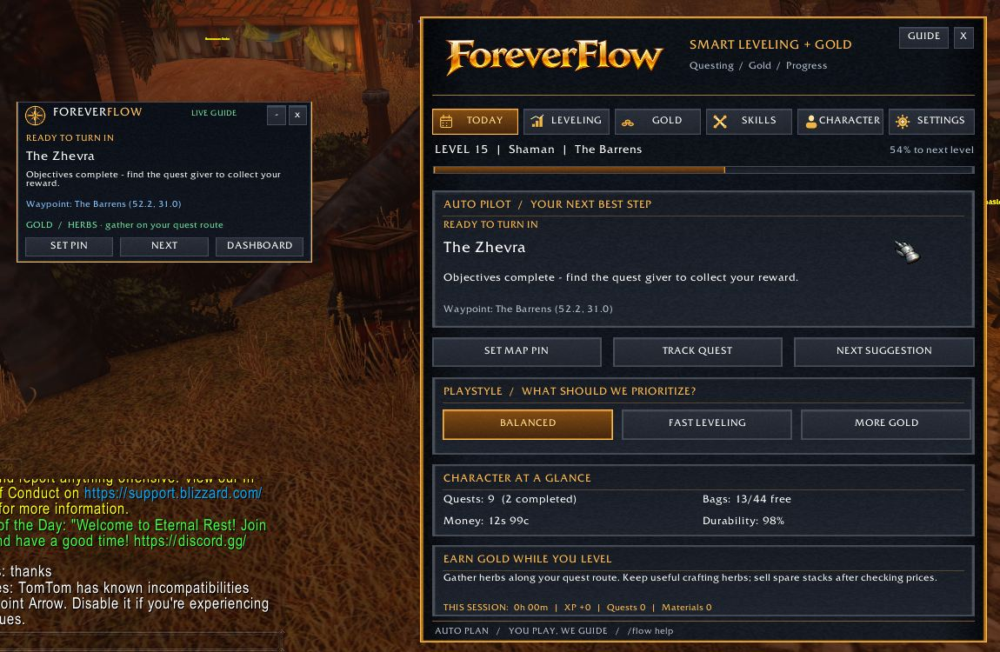

# ✦ ForeverFlow ✦

### Your adventure. A little more direction.

**Smart leveling · Quest guidance · Gold-making companion · Progress tracking**

*Built for World of Warcraft: Forever*

**Spend less time deciding what to do, and more time adventuring.**

---

## 🧭 What is ForeverFlow?

**ForeverFlow** is a lightweight, in-game **manual autopilot** for players who want a smoother journey through *WoW: Forever* without giving up the classic experience.

It reads supported in-game information about your **character, level, quests, zone, inventory, gold, and professions** and turns it into an approachable **“what should I do next?”** recommendation.

You move, fight, gather and sell. **ForeverFlow handles the suggestions.**

> **Beta note:** The current planner uses the quest log, character data and available client coordinates. It is **not** a complete, hand-authored fastest-leveling route database, and it does not provide live auction prices.

## ✨ Features at a glance

| | Feature | What it does |
|:--:|---|---|
| ⚔️ | **Smart quest recommendations** | Suggests a useful next quest from your available quest log. |
| 🗺️ | **Auto-follow & map guidance** | Attempts to watch/focus the recommended quest and use native coordinates when supported. |
| 📍 | **Live Guide ribbon** | Compact, movable HUD that updates as you progress. Expand it for more controls. |
| 💰 | **Gold alongside leveling** | Profession-aware gathering and gold tips without stopping your adventure. |
| 📈 | **Session progression** | Tracks supported XP, quest, money and material changes while you play. |
| 🎒 | **Character overview** | XP, level, bag slots, durability, quests, gold and profession status. |
| 🎛️ | **Playstyle selection** | Balanced, Fast Leveling or More Gold. |
| 🎨 | **Custom fantasy UI** | Gold-and-charcoal dashboard, branded minimap launcher and collapsible HUD. |

### See it in-game

Real gameplay screenshot · v0.5.1 UI before the v0.5.3 small-icon polish

## 🖥️ Two ways to use ForeverFlow

**The dashboard** is your planning hub: current recommendation, quick actions, playstyle, character snapshot and progression details.

**The Live Guide** stays in the corner while you play. It surfaces one immediate step without covering half the screen. Use the expand toggle when you want additional controls.

> **Have a suggestion?** The intended experience is *“you play, ForeverFlow guides.”* Feedback about bad recommendations, confusing quest tracking, and HUD placement is especially valuable.

## 📦 Installation

1. **[Download the v0.5.3 beta ZIP from GitHub Actions](https://github.com/justinbeatdown/ForeverFlow/actions/workflows/package.yml)** (open latest successful run > Artifacts > ForeverFlow-installable), or use the direct test ZIP provided in ChatGPT.
2. **Exit WoW completely.**
3. Remove the previous `Interface\AddOns\ForeverFlow` folder if one exists.
4. Extract the ZIP so this file exists: `Interface\AddOns\ForeverFlow\ForeverFlow.toc`
5. Log in. The Live Guide should appear automatically.
6. Type **`/flow`** to open the dashboard.

**Client:** World of Warcraft: Forever · addon interface **16001**.

*Do not extract the ZIP into an extra nested `ForeverFlow` folder.*

## 🎮 Commands

| Command | Action |
|---|---|
| `/flow` | Toggle the main dashboard |
| `/flow guide` | Toggle the Live Guide |
| `/flow hud tiny` | Small ribbon mode |
| `/flow hud normal` | Expanded guide with controls |
| `/flow next` | Try another quest recommendation |
| `/flow follow on` / `off` | Enable/disable automatic quest watch and focus |
| `/flow focus` | Retry quest tracking/focus |
| `/flow map` | Attempt a compatible map pin |
| `/flow debug` | Show status and last recorded Lua error |
| `/flow help` | List available commands |

### How auto-follow works

When the recommended quest or its objective changes, ForeverFlow **attempts** to watch and focus it using the Forever client’s available APIs. Where supported, it also uses client-supplied waypoint coordinates. It **does not invent destinations** or repeatedly override your navigation every refresh. Other quest addons and client restrictions may affect this feature.

## 🛡️ No gameplay botting

ForeverFlow **does not** move your character, fight, cast, loot, gather, buy or sell items. It does not send game data to an external service. It makes recommendations; **you make the decisions and play the game**.

## 🧪 Beta status & feedback

**Current build: v0.5.3 beta.**

- In-game UI, session tracking and quest recommendation features have been tested during development.
- Automatic quest watch/focus and compatibility with other navigation addons need more real-client validation.
- Quest pathfinding, complete optimized leveling routes and real-time auction valuations are **not** included yet.

Found a bug? Open an **[issue](../../issues/new)** and include your Forever client version, character level and zone, installed quest/navigation addons, reproduction steps and any Lua error (`/console scriptErrors 1`).

### Planned improvements

- [ ] More precise quest routing and turn-in selection
- [ ] Better gold-per-hour and profession planning using available local data
- [ ] HUD polish, scaling and placement presets
- [ ] Broader in-game compatibility and regression testing
- [ ] Community-requested quality-of-life features

## 🔧 Development notes

The full addon source, including game-ready textures, is tracked under [ForeverFlow/](ForeverFlow/). The complete installable beta is built on GitHub Actions as a downloadable artifact; compact icon textures are generated from the approved original artwork by `build_icons.py`. The repository is private while the project is in beta.

## 📄 License & attribution

**All rights reserved.** No open-source license is currently granted. Please do not redistribute, fork for redistribution, or repackage the source/artwork without permission.

ForeverFlow is an independent, community-created addon and is not affiliated with or endorsed by Blizzard Entertainment.

---

**Adventure more. Worry less. Let ForeverFlow guide the way.**

*ForeverFlow · WoW: Forever*

